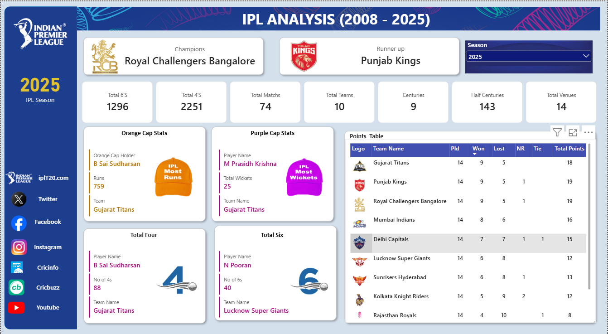

# 🏏 IPL Analytics Dashboard (2008–2025)

## 1. Project Title / Headline

**IPL Analytics Dashboard – Interactive Cricket Data Analysis Using Power BI**

## 2. Short Description / Purpose

The IPL Analytics Dashboard is an interactive data visualization project developed using Microsoft Power BI to analyze Indian Premier League (IPL) statistics from **2008 to 2025**.

The dashboard provides season-wise insights into team performances, player achievements, match statistics, and tournament results. It helps users explore historical IPL data, identify performance trends, and gain meaningful insights through interactive visualizations.

## 3. Tech Stack

The following tools and technologies were used to develop this project:

- **Microsoft Power BI** – Dashboard development and data visualization.
- **DAX (Data Analysis Expressions)** – Creating calculated measures and dynamic KPIs.
- **Power Query** – Data cleaning, transformation, and preprocessing.
- **CSV Files** – Storing and managing IPL datasets.
- **Data Modeling** – Establishing relationships between different datasets.

## 4. Data Source

The IPL datasets used in this project were collected from **Kaggle**.

The data covers IPL seasons from **2008 to 2025** and includes information about:

- IPL match details.
- Ball-by-ball match statistics.
- Player information and performance.
- Team details and tournament results.

The datasets were cleaned, transformed, and prepared using Power Query before being used for dashboard development.

## 5. Features / Highlights

### 🏆 Tournament Analysis
- Season-wise IPL tournament analysis.
- Tournament Winner and Runner-up identification.
- Team performance comparison across seasons.

### 📊 Match Statistics
- Total matches and match-related statistics.
- Total Fours (4s) and Sixes (6s) in each season.
- Interactive season-wise analysis.

### 🏏 Player Performance Analysis
- Orange Cap holder identification.
- Purple Cap holder identification.
- Centuries and Half-Centuries analysis.
- Player-wise performance insights.

### ⚡ Interactive Dashboard
- Dynamic season selection using slicers.
- KPI cards for important statistics.
- Interactive charts, tables, and visualizations.
- Dynamic team logos and player images.
- DAX measures for season-wise calculations.
- Interactive navigation buttons that redirect users to official IPL websites and teams' social media platforms.
- Seamless navigation through external links for quick access to IPL-related information.

## 6. Screenshots / Demo

### Dashboard Overview

<!-- Add your dashboard screenshot below -->

**Project Domain:** Data Analytics | Business Intelligence | Cricket Analytics

**Developed by:** Chirag Attri
